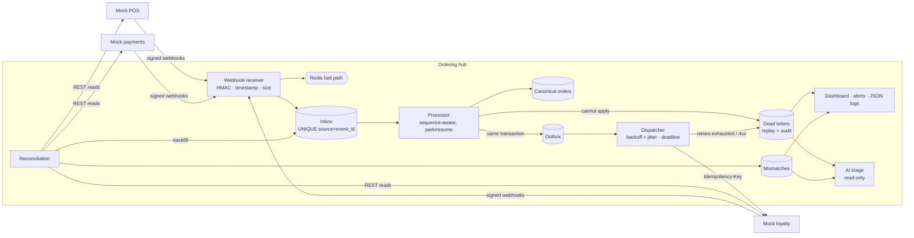

# Integration Reliability Lab

An ordering hub that integrates a **POS**, a **payment provider** and a
**loyalty platform**, built the way a Forward Deployed Engineer has to build
integrations at a customer site: assume every webhook can arrive twice, late,
out of order or forged, every outbound call can time out, and every pair of
systems will eventually disagree. Then make each of those failures detectable,
safe to retry and explainable. **All data is synthetic, all external systems are
mocks, and no secret is hardcoded.**

> Status: **all 5 milestones complete** ([roadmap](docs/ROADMAP.md)).
> 303 tests pass on SQLite and on PostgreSQL 16 + Redis 7. The six failure
> scenarios pass against the Docker Compose stack.

## Problem

A café chain (the fictional *Demo Bistro Group*) sells through store POS
terminals, takes card payments through a payment provider, and rewards
customers through a loyalty platform. The team that has to make those systems
agree owns none of them. In production, the integration layer decides whether:

- a provider's webhook retry becomes a **second order** or **double points**,
- a payment that captured **133 TRY of a 190 TRY order** gets noticed,
- an `order.cancelled` that arrives **before** `order.created` corrupts state,
- a POS order for a loyalty member who **doesn't exist** at the loyalty
  platform disappears silently or lands in a queue someone can act on,
- a **timeout** on an outbound call is retried safely or credits points twice,
- finance's numbers and the systems' numbers **drift apart** without anyone
  noticing.

The lab injects those failures on purpose. It covers six scenarios: duplicate
webhook, timeout, partial payment, out-of-order event, missing customer record,
and data mismatch between systems. It shows the patterns that contain each one,
and measures them.

## Architecture



Webhooks are verified against the raw bytes (an HMAC with the timestamp inside
it) and deduplicated in two layers. Redis is the fast path. A unique constraint
in the database is the guarantee. A worker projects each event into a canonical
order in **one transaction** that also writes any outbound call to the
**outbox**. The dispatcher sends those calls with a **stable Idempotency-Key**,
a deadline on each attempt, and exponential backoff with full jitter. Anything
that needs a person goes to the **dead-letter queue**, where it can be triaged
and replayed with an audit trail. **Reconciliation** reads each provider's own
records, flags typed mismatches, and backfills dropped webhooks.

More detail: [architecture](docs/architecture.md) ·
[data model](docs/data-model.md) · [Docker deployment](docs/docker.md) ·
[runbook](docs/runbook.md) ·
[how this maps to payments, APIs and customer deployments](docs/payments-apis-deployments.md).

## Demo

`python -m irlab.demo` runs the whole story in-process, with a temporary
database and freshly generated secrets. This is its real output:

```text
1) Happy path: POS order → signed webhook → payment → loyalty points (via the outbox)
   POS order                          POS-000001 total 190.00 TRY
   hub                                {"status": "paid", "loyalty_status": "accrued", "points_awarded": 190}
   events                             ["order.created:processed", "payment.authorized:processed", "payment.captured:processed"]
   outbox                             ["loyalty.accrue key=loyalty-accrual:POS-000001 sent"]

2) Duplicate webhooks: every POS webhook delivered 3×
   hub answers                        ["202 accepted", "200 duplicate", "200 duplicate"]
   forged copy                        401 invalid_signature

3) Timeout: loyalty does the work but replies after the hub's 0.5 s deadline
   hub outbox (stable key)            sent after 2 attempts → 1 accrual at the provider
   naive client (new key per retry)   2 accruals → double points

4) Partial payment: 190.00 TRY order, 133.00 TRY captured
   hub                                {"status": "partially_paid", "captured_minor": 13300, "loyalty_status": "not_due"}

5) Out of order: order.cancelled (v2) arrives before order.created (v1)
   after v2 only                      ["v2:parked"]
   after v1 arrives                   ["v2:processed", "v1:processed", "order cancelled v2"]

6) Missing customer record: member LM-1005 deleted at the loyalty platform
   dead letter                        #1 member_not_found after 1 attempt (no wasted retries)
   triage (mock, read-only)           docs/runbook.md#member-not-found — Look the member up at the loyalty provider (GET /members/{id}, or by phone).
   replay after the fix               succeeded → 1 accrual

7) Data mismatch: a POS webhook is dropped; reconciliation compares every system
   hub knows the order?               no
   reconciliation                     {"orders_checked": 7, "mismatches_found": 2, "repairs_queued": 1, "by_kind": {"missing_in_hub": 1, "partial_payment": 1}}
   after backfill                     order paid (from the POS REST snapshot)
   next run                           {"mismatches_found": 1, "resolved_mismatches": 1}
   still open for a human             ["partial_payment POS-000004"]

8) Alerts and the dashboard
   firing                             ["open_mismatches"]
   webhook receipts                   {"accepted": 22, "duplicate": 2, "rejected": 1}
   dead letters open                  none
   replays                            {"succeeded": 1}
   dashboard: /dashboard (uvicorn irlab.main:app, or Docker Compose on :8100)
```

For a narrated version on the Docker Compose stack, with the dashboard open,
see [docs/demo-script.md](docs/demo-script.md).

## Measured Results

All numbers come from the scenario runner (`python -m irlab.scenarios`), with
50 orders per scenario, measured on 2026-11-08 on a MacBook (Darwin arm64,
Python 3.13). The two runs are:

- **In-process:** SQLite and the in-memory idempotency store, no network.
- **Compose:** PostgreSQL 16, Redis 7, and the hub, worker and three providers
  as separate containers talking HTTP.

Full output: [in-process](docs/results/scenarios-in-process.md) ·
[Compose](docs/results/scenarios-compose.md).

| Scenario | What was measured | In-process | Compose |
|---|---|---|---|
| Duplicate webhook | 350 redeliveries (every webhook sent 2–3×) answered `200 duplicate` | **100 %**, 0 duplicate rows | **100 %**, 0 duplicate rows |
| | Orders double-credited | 0 / 50 | 0 / 50 |
| Timeout | Accruals delivered, where the provider did the work and replied after the deadline | 50 / 50 | 50 / 50 |
| | Retries per success | 1.0 | 1.0 |
| | Double credits with the stable key | **0 / 50** | **0 / 50** |
| | Double credits with a fresh key per retry (naive client) | **50 / 50** | **50 / 50** |
| Partial payment | Partial captures detected / false positives | 25 / 25 · 0 | 25 / 25 · 0 |
| Out-of-order | Events parked (peak) → resumed when the gap closed | 30 → 25 | 30 → 25 |
| | Gaps that never closed: dead-lettered, then recovered by reconciliation | 5 → 5 | 5 → 5 |
| | Hub state matching the POS afterwards | 100 % (55 orders) | 100 % (55 orders) |
| Missing customer record | Dead-lettered after **1** attempt (no wasted retries) | 50 / 50 | 50 / 50 |
| | Replay success after the record was restored | 100 % (0 double credits) | 100 % (0 double credits) |
| Data mismatch | Injected mismatches detected (5 kinds), with 0 false positives | 42 / 42 | 42 / 42 |
| | Dropped webhooks repaired automatically by backfill | 26 / 26 | 26 / 26 |
| | Money and points issues left open for a person | 16 | 16 |
| Receiver | Time inside the webhook handler, p50 / p95 | 0.8–1.0 ms / 1.1–3.4 ms (per scenario) | 1.0 ms / 2.5 ms (all 1,554 deliveries) |

**How to read the times.** Reconciliation finds a problem on its first run
after the problem appears. In these runs the median time to detection,
measured from order creation, was 0.6–1.0 s in-process and 2.7–3.0 s on
Compose (with a 2 s grace period). In production it is bounded by
`RECONCILE_INTERVAL_S` (60 s) plus `RECONCILE_GRACE_S` (30 s). A dead letter
appears as soon as the worker processes the call: median 0.9 s in-process and
0.4 s on Compose, after the order. The receiver time measures only the webhook
handler, not the network.

**Tests:** 303 passed and 0 failed on SQLite (~22 s). The same 303 passed
against PostgreSQL 16 + Redis 7 from the host, and inside the Compose `test`
profile. Mutation checks: 9 deliberate bugs were injected one at a time, and
each one made tests fail. For example, a per-attempt idempotency key failed 4
tests, and switching off sequence parking failed 10. Details:
[test report](docs/test-report.md).

**Not measured:**
- throughput or load
- more than one worker replica
- real third-party providers
- the Claude triage path against the live API (no API key on the build machine;
  it is tested through the official SDK with a mock transport)
- TLS

The latencies were measured on a laptop and are not a capacity claim.

## Failure Modes

| Scenario | What the hub does | Test |
|---|---|---|
| **Duplicate webhook** | It answers `200 duplicate`, keeps one inbox row and counts `delivery_count`. Concurrent copies get `409` with `Retry-After`. A reused id with a different payload is flagged. | `test_webhook_receiver.py`, `test_failure_scenario[duplicate_webhook]` |
| **Timeout** | Each attempt has a deadline. The retry uses the same Idempotency-Key, so the provider replays its earlier answer. Backoff is exponential with full jitter. When the budget runs out, the call goes to the DLQ as `retries_exhausted`. | `test_outbox_and_replay.py`, `test_failure_scenario[timeout]` |
| **Partial payment** | The order becomes `partially_paid` and earns no points. Reconciliation opens a `partial_payment` mismatch for a person. | `test_reconciliation.py`, `test_failure_scenario[partial_payment]` |
| **Out-of-order event** | It parks the event until the gap closes, then resumes. A payment that arrives before its order is folded in later. A gap that never closes is dead-lettered after the park timeout, and the next backfill supersedes it. | `test_processing.py`, `test_failure_scenario[out_of_order]` |
| **Missing customer record** | The 404 goes to the DLQ as `member_not_found` after one attempt. Triage points to the runbook. After the fix, a replay with the same key credits points exactly once. | `test_outbox_and_replay.py`, `test_failure_scenario[missing_customer]` |
| **Data mismatch** | Reconciliation compares the hub with each provider and finds 11 mismatch kinds. Dropped webhooks are backfilled. Double charges, double points and points on unpaid orders stay open for a person. | `test_reconciliation.py`, `test_failure_scenario[data_mismatch]` |

Also handled and tested:
- a forged or tampered signature, or one made with another source's secret
- a replayed request outside the 300 s window
- secret rotation
- a source with no secret configured (fails closed)
- a malformed envelope or an oversized body
- a database write failure (the claim is released, so the retry succeeds)
- Redis flushed or down (the database still deduplicates; `/health` reports
  `degraded`)
- a projection crash mid-transaction (nothing is half-written)
- a crashed worker (its lease expires and the work is retried with the same key)
- two dispatchers racing for one message (it is sent once)
- an order cancelled before its accrual was sent (the accrual is skipped)
- a provider that is down during reconciliation (the run is marked `partial`,
  with no false positives)
- a spike in signature failures (critical alert)
- HTML injection on the dashboard (values are escaped)
- a triage model that refuses or returns junk (falls back to the mock)

Known limits are listed in [architecture.md](docs/architecture.md#known-limitations).
What to do when something fails is in the [runbook](docs/runbook.md).

## How to Run

Requires Python 3.11+. Docker is only needed for the Compose stack.

```bash
python3 -m venv .venv && source .venv/bin/activate
pip install -e ".[dev]"
```

Create `.env` with freshly generated secrets: webhook secrets, the operator key
and the Postgres password. It is never committed.

```bash
python -m irlab.devtools init-env
```

**Locally**, one process runs the hub, the three mock providers under
`/mock/...` and the worker. The dashboard is at
http://localhost:8000/dashboard and the API docs at http://localhost:8000/docs.

```bash
uvicorn irlab.main:app --reload
```

```bash
curl -s -X POST localhost:8000/mock/pos/orders -H 'content-type: application/json' -d '{"store_id":"ST-IST-01","items":[{"sku":"SKU-LATTE","qty":2}],"loyalty_member_id":"LM-1001"}'
```

```bash
curl -s -X POST localhost:8000/mock/payments/payments -H 'content-type: application/json' -H 'Idempotency-Key: pay-POS-000001' -d '{"order_ref":"POS-000001","amount_minor":19000}'
```

```bash
curl -s localhost:8000/v1/orders/POS-000001
```

**With Docker Compose**, the stack is hub, worker, three providers, PostgreSQL
16 and Redis 7, on 127.0.0.1:8100–8103. Full instructions:
[docs/docker.md](docs/docker.md).

```bash
docker compose up -d --build
```

```bash
python -m irlab.scenarios --target http --orders 50
```

**Demo, scenarios and tests:**

```bash
python -m irlab.demo
```

```bash
python -m irlab.scenarios --orders 50 --markdown docs/results/scenarios-in-process.md
```

```bash
pytest -q
```

```bash
docker compose --profile test run --rm tests
```

The last command runs the suite against the Compose PostgreSQL and Redis.

**Optional Claude triage.** By default triage is mock and read-only. Install
the extra, set `TRIAGE_PROVIDER=anthropic` and `ANTHROPIC_API_KEY` in `.env`,
and restart the hub. If the API is unavailable or the answer is invalid, triage
falls back to the mock answer and says why.

```bash
pip install -e ".[ai]"
```

Configuration is environment-only; see [.env.example](.env.example).
Operator writes (replay, discard, reconcile, worker tick) need the
`X-Ops-Key` header. Without `OPS_API_KEY` configured, they answer 503.
