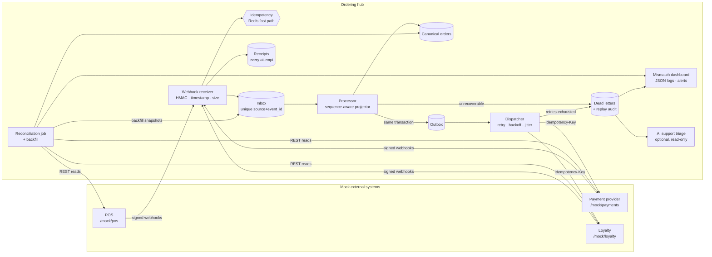
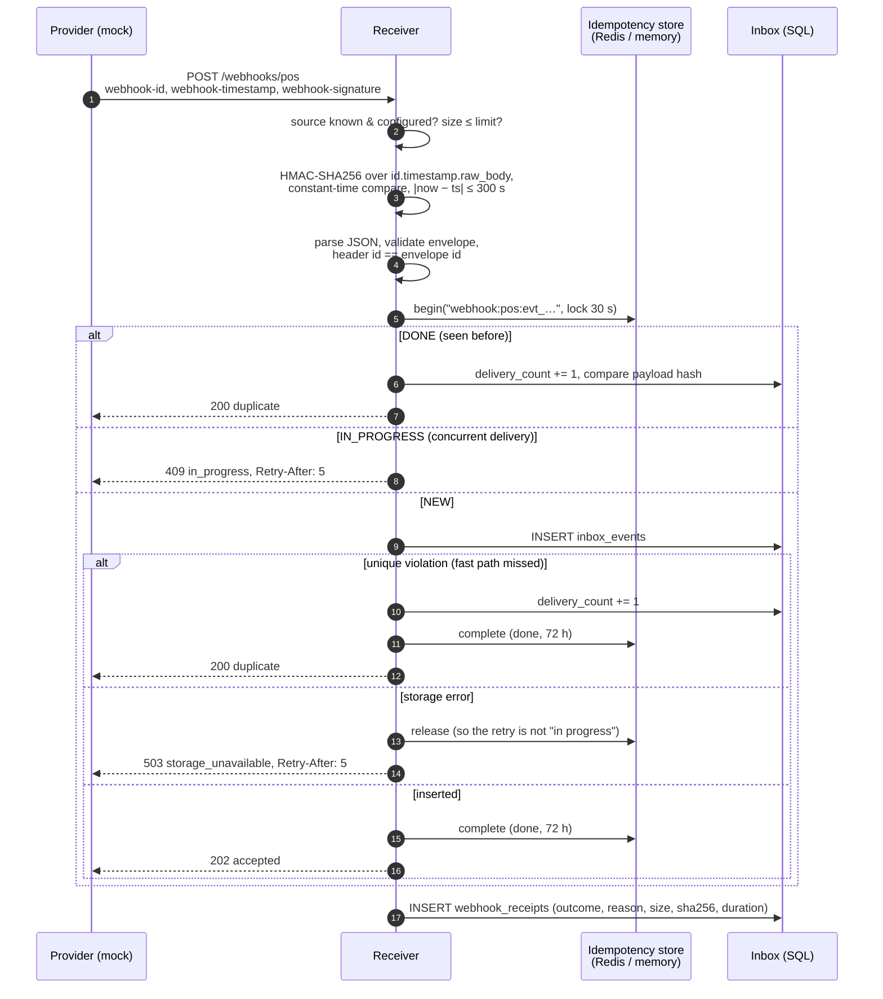
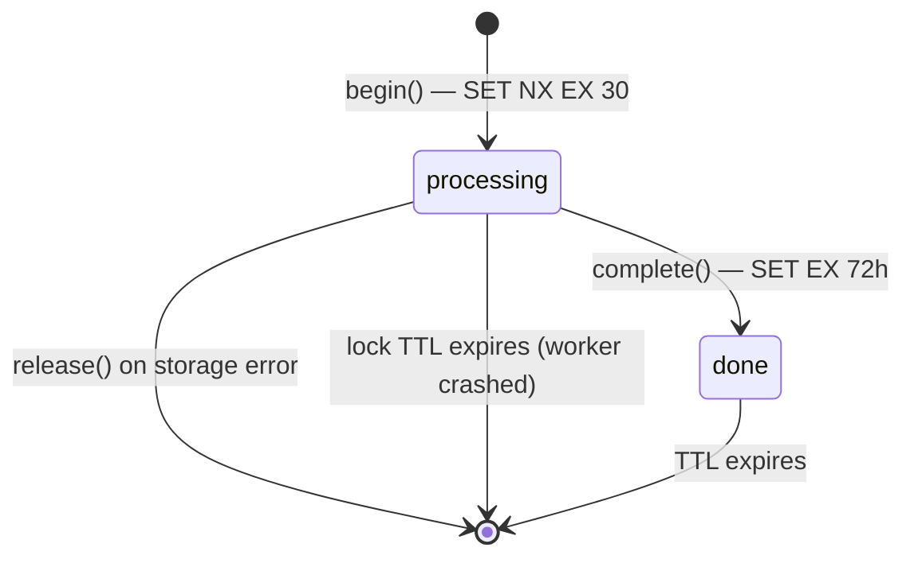
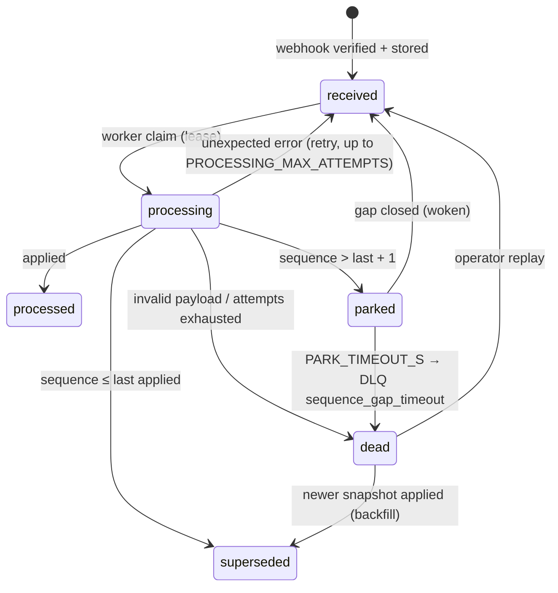
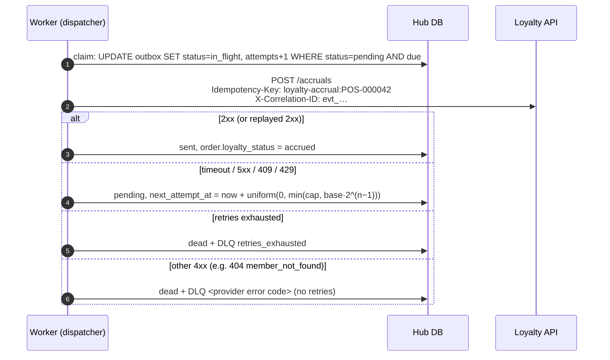

# Architecture

## Context

**Demo Bistro Group** (fictional) runs cafés in Istanbul and Ankara. Three
systems it does not own have to agree about every order:

| System | Role | Talks to the hub via |
|---|---|---|
| Store **POS** | Rings up orders, owns menu prices | `order.*` webhooks; REST for lookups |
| **Payment provider** | Authorises and captures card payments | `payment.*` webhooks; REST for lookups/captures |
| **Loyalty platform** | Member records, points | REST for accruals; `points.*` webhooks |

The **ordering hub** (this service) is the one place where an order, its
payment and its loyalty points come together. Its job is to stay correct while
the other three behave like real integrations do: retrying, timing out,
arriving out of order, disagreeing with each other.

## Component view



Every box is implemented. The receiver, inbox and idempotency layer came in
Milestone 1. The processor, outbox, dispatcher, DLQ and replay came in M2.
Reconciliation, the dashboard, JSON logs and alerts came in M3. The scenario
runner and triage came in M4. Docker Compose came in M5 (see
[Deployment](#deployment-milestone-5)).

## Webhook ingestion (Milestone 1)



### Response contract

Senders retry anything that is not 2xx, so the codes are chosen for what the
sender should do next, not only for what happened:

| Status | Meaning | Sender should |
|---|---|---|
| 202 `accepted` | New event stored | stop |
| 200 `duplicate` | Already stored (`payload_matches` tells if the bytes agree) | stop |
| 409 `in_progress` | Same event is being stored right now | retry after `Retry-After` |
| 503 `storage_unavailable` | Our database failed; claim released | retry after `Retry-After` |
| 503 `source_not_configured` | No secret configured for this source | alert a human (config) |
| 401 `invalid_signature` / `timestamp_out_of_tolerance` | Authentication failed | not retry blindly; check secret / clock |
| 400 | Malformed headers, JSON or envelope | not retry; fix the sender |
| 404 / 413 | Unknown source / body too large | not retry |

### Signature scheme

Modeled on the Standard Webhooks header convention (see `irlab/signing.py`):

```
signed_content = f"{webhook-id}.{webhook-timestamp}." + raw_body
webhook-signature: v1,<base64(HMAC-SHA256(secret, signed_content))> [v1,<…> …]
```

- **Raw bytes.** The receiver verifies the exact bytes on the wire before
  parsing. Re-serialising JSON before verifying is a classic bug (key order,
  whitespace, unicode escaping all change the bytes).
- **Timestamp inside the MAC.** A captured request cannot be replayed with a
  fresh timestamp; the 300 s window bounds how long a captured request is useful.
  Because duplicates are deduplicated by event id anyway, the window is about
  limiting exposure, not about correctness.
- **Rotation.** `POS_WEBHOOK_SECRETS="new,old"` accepts both during a
  rotation; a sender may also dual-sign (`v1,<new> v1,<old>`).
- **Fail closed.** No secret configured → 503 for that source. An empty
  secret never means "accept unsigned".
- **No unauthenticated storage.** Rejected attempts are recorded in
  `webhook_receipts` with size and SHA-256 only — no body, no event id.

### Idempotency: two layers



1. **Fast path (Redis, or in-memory for single-process runs).** Turns
   redeliveries into a cheap lookup and serialises concurrent deliveries of the
   same event. A short `processing` TTL means a crashed worker can never turn an
   event into a phantom "duplicate".
2. **Source of truth (database).** `UNIQUE (source, event_id)` on
   `inbox_events`. If Redis is flushed, evicts, expires, or is down, the insert
   hits the constraint and the delivery is still answered as a duplicate. If the
   store is unreachable the receiver **fails open on the fast path only** and
   `/health` reports `degraded`.

Duplicate deliveries whose payload hash differs from the first delivery are
counted in `conflicting_deliveries` and logged: the first payload is kept (the
event id is the provider's promise that the content is the same).

### Event envelope

```json
{
  "id": "evt_b8d80f1ae70843b28aad17e9",
  "type": "order.created",
  "occurred_at": "2026-11-08T09:41:12.004Z",
  "resource": {"type": "order", "id": "POS-000001"},
  "sequence": 1,
  "data": {"...": "provider snapshot of the resource"}
}
```

`sequence` is the provider's per-resource version. Providers do not promise
ordering; M2 uses `(resource, sequence)` to park events that arrive ahead of a
gap and resume them when the gap closes. Event types the hub does not consume
are stored as `ignored` and acknowledged with 202, so a provider adding a new
event type never causes a retry storm.

## Processing (Milestone 2)

The worker claims each `received` inbox event with a compare-and-set update and
a lease (`claimed_until`). It then applies the event in **one transaction**,
which covers the projection (`orders`, `order_payments`), the per-resource
sequence (`resource_versions`), any outbox message, and the event's status. No
network call happens inside that transaction.



- **Ordering.** POS orders and payments carry a per-resource `sequence`. An event
  that arrives ahead of a gap is **parked** and woken when the gap closes. A gap
  that never closes is dead-lettered after `PARK_TIMEOUT_S`, and the next
  reconciliation backfill makes it `superseded`.
- **Cross-provider order.** A payment may arrive before its order. It is stored
  under its `order_ref` and folded in when the order arrives, because the money
  state is computed from *all* payments of the order.
- **Derived status.** `cancelled`, `paid`, `partially_paid`, `overpaid`,
  `payment_failed` or `awaiting_payment`. Loyalty points are queued only when
  the order is exactly `paid`.
- **Multiple workers.** On PostgreSQL each transaction takes
  `pg_advisory_xact_lock` on the *order*. The lock is per order, not per
  resource, because payment and loyalty events update the order row too.

## Outbox and retries (Milestone 2)



- **Stable key per business action.** Every retry and every replay sends the
  same key. A timeout is ambiguous, because the provider may already have done
  the work. The timeout scenario measures what happens with a fresh key per
  retry: double points on every timed-out call.
- **Deadline per attempt.** `asyncio.timeout(OUTBOUND_TIMEOUT_S)`, because
  ASGITransport ignores httpx timeouts. Real sockets also get the httpx timeout.
- **Lease recovery.** A message that stays `in_flight` past its lease (the
  worker crashed) goes back to `pending` and is resent with the same key.
- **Cancelled before send.** If the order was cancelled before the accrual went
  out, the message is marked `skipped`.

## Dead letters and replay (Milestone 2)

There is one `dead_letters` row per failed item (`UNIQUE(origin, origin_id)`).
Its reason code says what a person has to do: `member_not_found`,
`retries_exhausted`, `sequence_gap_timeout`, `invalid_payload`,
`processing_failed`, or a provider code such as `idempotency_key_reused`.

A replay (single, or bulk by reason) resets the item and runs one attempt
immediately. The outbox message gets a fresh retry budget and keeps the *same*
key. The inbox event goes back to `received`. The response is `succeeded`,
`failed_again` (the same row reopens and `times_dead_lettered` goes up) or
`retry_scheduled`. Every replay and discard writes a `replay_requests` row with
who, when, why and the result. Writes need `X-Ops-Key`, and they fail closed
with 503 when no key is configured.

## Reconciliation (Milestone 3)

Webhooks are a notification channel, not a ledger. The reconciler reads each
provider's REST API (POS orders, payments, loyalty accruals) and compares it
with the hub. Each difference becomes a typed **mismatch**: one open row per
(kind, entity). Re-detecting it updates the row, and when it disappears the
row resolves.

| Kind | Severity | Repair |
|---|---|---|
| `missing_in_hub`, `status_mismatch` | critical / warning | **backfill** the POS snapshot |
| `payment_missing_in_hub`, `payment_status_mismatch` | warning | **backfill** the payment snapshot |
| `partial_payment`, `overpayment`, `orphan_payment` | warning / critical | manual (collect, refund) |
| `duplicate_accrual`, `points_mismatch`, `points_on_unpaid_order`, `points_missing` | critical / warning | manual (reverse, adjust) |

- **Backfill** writes the provider's current snapshot into the inbox with
  `origin=reconciliation` and `skip_sequence_check`. The same processor applies
  it. The event id `backfill:<entity>:v<version>` is deterministic, so a
  snapshot is queued once no matter how many runs see the gap.
- **No noise.** Records younger than `RECONCILE_GRACE_S` are skipped, and so
  are resources whose event is already in the inbox but not applied yet.
- A provider that cannot be read makes the run `partial`, and the checks that
  depend on it are skipped. A missing provider never produces false positives.

## Observability (Milestone 3)

- **JSON logs** (`LOG_FORMAT=json`). Every line carries the correlation id from
  a context variable: the webhook's event id through processing, the outbox
  call (sent to the provider as `X-Correlation-ID`), the DLQ and the replay.
  HTTP requests accept or generate `X-Correlation-ID` and echo it back.
  Malformed incoming ids are replaced, so no log injection is possible.
- **Alerts** are rule rows over the hub's own tables: `dlq_depth`,
  `retries_exhausted`, `signature_failures`, `open_mismatches` and
  `stale_parked_events`. A sink is notified once when a rule starts firing and
  once when it resolves. Sinks are the log and an optional webhook
  (`ALERT_WEBHOOK_URL`).
- **Dashboard** (`/dashboard`): read-only server-rendered HTML that refreshes
  every 10 s. It shows open mismatches, the DLQ, parked events, alerts,
  receipts, receiver latency p50/p95, pipeline counts and the replay audit.
  Every value is HTML-escaped. The same numbers are available as JSON at
  `/v1/summary`.

## AI-assisted triage (Milestone 4)

`GET /v1/dead-letters/{id}/triage` and `GET /v1/mismatches/{id}/triage` return
a summary, the likely cause, the runbook section, next steps, the customer
impact and a confidence level.

- **Mock** (default) uses deterministic rules per reason code or mismatch kind,
  and works offline.
- **Claude** (`TRIAGE_PROVIDER=anthropic`, `pip install -e ".[ai]"`) uses the
  official SDK with structured JSON output. The answer is validated against the
  same schema, and `runbook_section` must be one of a fixed list. The model is
  given no tools. Provider text goes to it inside a delimited block with an
  instruction to treat it as data. A refusal, invalid JSON or an API error falls
  back to the mock answer and says why.

## Deployment (Milestone 5)

See [docker.md](docker.md) for the Compose topology: hub API, worker, three mock
provider containers, PostgreSQL 16, Redis 7, and a one-shot Alembic `migrate`
service. Every port is bound to 127.0.0.1.

## Mock providers

Each mock (`irlab/mocks/`) is its own FastAPI app with its own in-memory state.
Locally the hub mounts them under `/mock/{pos,payments,loyalty}` and they
deliver webhooks to the hub in-process; in Docker Compose (M5) each runs as its
own container (`irlab.mocks.serve`).

| | POS | Payments | Loyalty |
|---|---|---|---|
| Resources | stores, menu, orders | payments | members, accruals |
| Writes | `POST /orders`, `POST /orders/{id}/cancel` | `POST /payments`, `POST /payments/{id}/capture` | `POST /accruals` |
| `Idempotency-Key` | optional | **required** | **required** |
| Webhooks | `order.created`, `order.cancelled` | `payment.authorized`, `payment.captured`, `payment.failed` | `points.accrued` |
| Scenario hooks | — | partial capture, `test_card_declined` | `PUT/DELETE /_admin/members/{id}` (missing record) |

Provider-side `Idempotency-Key` semantics: same key + same request → original
response replayed (`Idempotent-Replayed: true`); same key + different request →
422; same key in flight → 409; only 2xx responses are cached, so a 404 for a
missing member does not poison the key for the retry after the data is fixed.
Loyalty accruals deliberately do **not** deduplicate on `order_ref`: the key is
the only protection, which is what makes the M2 outbox design testable.

Every mock has a control plane under `/_admin` (never faulted itself):

| Fault | Effect | Scenario it feeds |
|---|---|---|
| `fail_next`, `fail_status` | next N business calls fail with that status | retries, DLQ (**M2**) |
| `latency_ms` | delay before every business call | slow provider |
| `slow_next`, `slow_response_ms` | next N calls are processed, then answered late | timeout (**M2/M4**): work done, reply after the caller's deadline |
| `webhook_copies` = 0 | webhooks dropped (held for manual delivery) | data mismatch → reconciliation (**M3**), out-of-order (**M4**) |
| `webhook_copies` ≥ 2 | each webhook delivered N times | duplicate webhook (**M1**) |
| `POST /_admin/webhooks/{id}/deliver` | redeliver one event now | duplicate webhook (**M1**), out-of-order (M4) |

## Failure handling in Milestone 1

| Situation | Behaviour | Test |
|---|---|---|
| Provider retries a delivered webhook | 200 duplicate, `delivery_count` += 1, one inbox row | `test_duplicate_delivery_is_acknowledged_not_stored_twice`, `test_provider_retry_is_deduplicated` |
| Same webhook delivered 3× for 4 orders | 4 rows, 8 duplicate receipts | `test_duplicate_storm_from_provider` |
| Five concurrent deliveries of one event | exactly one 202; others 200 or 409 + Retry-After | `test_concurrent_duplicate_deliveries_store_exactly_one` |
| Database write fails mid-delivery | 503, claim released, next retry 202 | `test_storage_failure_releases_claim_so_retry_is_accepted` |
| Redis flushed / key expired | unique constraint → 200 duplicate | `test_db_constraint_dedupes_when_fast_path_forgets` |
| Redis down | fail open on fast path, DB dedupes, `/health` degraded | `test_idempotency_store_outage_fails_open_to_db_constraint` |
| Forged / tampered / wrong-source signature | 401, nothing stored, no event id recorded | `test_tampered_body_is_rejected_and_not_stored` and others |
| Captured request replayed later | 401 `timestamp_out_of_tolerance` | `test_replayed_or_future_timestamp_is_rejected` |
| Secret rotation | old and new both verify; retired secret 401 | `test_secret_rotation_accepts_old_and_new` |
| Source without secret | 503 `source_not_configured` (fail closed) | `test_unconfigured_source_fails_closed` |
| Event id reused with different payload | 200 duplicate, `payload_matches=false`, first kept, counted | `test_reused_event_id_with_different_payload_is_flagged_and_first_kept` |
| Unknown event type | 202, stored as `ignored` | `test_unknown_event_type_is_acknowledged_and_ignored` |
| Oversized body | 413 before any HMAC work | `test_oversized_body_is_413` |
| Hub unreachable from provider | provider records `ConnectError`, its own API still succeeds | `test_unreachable_hub_is_recorded_not_raised` |
| Webhook dropped by provider | hub has no trace (gap for M3 reconciliation to find) | `test_dropped_webhook_leaves_no_trace_in_hub` |

## Failure handling (Milestones 2–4)

| Situation | Behaviour | Test |
|---|---|---|
| `order.cancelled` before `order.created` | v2 parked, v1 applied, v2 resumed | `test_out_of_order_event_is_parked_then_resumed` |
| Payment webhook before the order | stored by `order_ref`, folded in later | `test_payment_before_order_is_folded_in_when_order_arrives` |
| Gap never closes | DLQ `sequence_gap_timeout` → replay as snapshot, or backfill supersedes it | `test_gap_that_never_closes_is_dead_lettered_then_replayed_as_snapshot`, `test_backfilled_newer_snapshot_resolves_gap_dead_letter` |
| Projection crashes mid-transaction | nothing half-written (no order change, no outbox row) | `test_failed_projection_rolls_back_atomically` |
| Loyalty 503 twice | retried with full-jitter backoff, accrued once | `test_transient_5xx_is_retried_with_backoff_then_succeeds` |
| Loyalty down for the whole budget | DLQ `retries_exhausted`, replay after recovery | `test_retries_exhausted_goes_to_dead_letter_queue` |
| Loyalty did the work but answered late | same key on retry → replayed answer, points once | `test_timeout_after_provider_did_the_work_does_not_double_credit` |
| …the same with a fresh key per retry | double points (the bug the design prevents) | `test_naive_retry_with_fresh_keys_double_credits` |
| Member missing at loyalty | DLQ after 1 attempt; replay fails again until fixed; then once | `test_missing_member_dead_letters_without_wasting_retries_then_replays` |
| Worker crashed mid-send | lease expires, resent with the same key | `test_expired_in_flight_claim_is_recovered_and_resent_with_same_key` |
| Two dispatchers race for one message | exactly one sends | `test_concurrent_dispatch_of_one_message_sends_once` |
| Order webhook dropped | `missing_in_hub`, backfilled, resolved `repaired` | `test_dropped_order_webhook_is_detected_and_repaired_by_backfill` |
| Cancellation dropped | `status_mismatch`, backfilled | `test_dropped_cancellation_is_a_status_mismatch` |
| Partial capture / double charge / double points | `partial_payment` / `overpayment` / `duplicate_accrual`, left open for a person | `test_reconciliation.py` |
| Provider down during reconciliation | run `partial`, no false positives | `test_provider_outage_makes_a_partial_run_without_false_positives` |
| Signature-failure spike | critical alert with per-source breakdown | `test_signature_failure_spike` |
| Untrusted text on the dashboard | HTML-escaped | `test_dashboard_escapes_untrusted_text` |
| Triage model refuses / returns junk / is unreachable | mock answer + `fallback_reason` | `test_claude_provider_falls_back_to_mock_and_says_why` |

## Known limitations

- Rejected attempts are written to `webhook_receipts`. Under a flood of forged
  requests that table becomes a target for write amplification. Production would
  sample these writes or rate-limit them at the edge.
- `release()` on the Redis fast path is a plain `DEL`, not a compare-and-delete.
  At worst this lets a third delivery race to the insert, where the unique
  constraint still rejects it.
- Reconciliation reads at most 1,000 records per provider per run, and only
  compares records created inside its window.
- The mocks never send `order.updated`, `payment.refunded` or
  `points.reversed`. The processor handles the first two as snapshots and
  records the third without acting on it.
- Operator reads are open and writes use one shared key. A real deployment puts
  SSO in front of both.
- More than one worker replica is designed for (leases, compare-and-set claims,
  advisory locks) but has not been load-tested.
