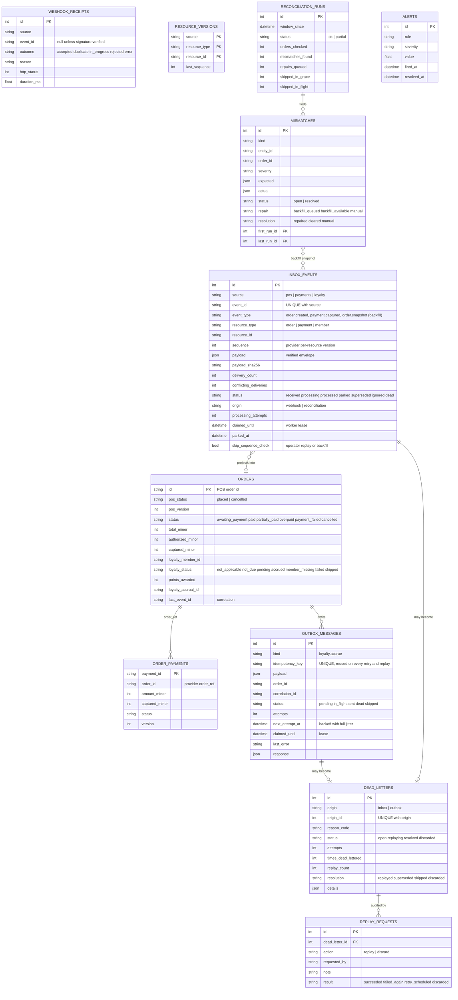

# Data model

The hub owns one SQL database: SQLite for local runs and tests, PostgreSQL 16
under Docker Compose, with the schema created by the Alembic migration
`migrations/versions/0001_*`. The mock providers keep their own in-memory state
and can be reached only over HTTP, like real external systems. Amounts are
always integer **minor units** (kuruş) plus a currency code. Timestamps are
timezone-aware UTC (`irlab.db.UTCDateTime`). JSON columns are `JSONB` on
PostgreSQL.

## Tables

| Table | Milestone | Purpose |
|---|---|---|
| `inbox_events` | M1 (+M2 columns) | One row per verified `(source, event_id)`. Holds the deduplicated webhook log, the processing status and the lease. |
| `webhook_receipts` | M1 | Every HTTP delivery attempt, including duplicates and rejections. Only the size and SHA-256 of the body are stored. |
| `orders` | M2 | Canonical order: the POS snapshot plus derived payment and loyalty state |
| `order_payments` | M2 | Payment snapshots, keyed by `order_ref`. A payment may exist before its order. |
| `resource_versions` | M2 | Highest provider `sequence` applied per resource (out-of-order handling) |
| `outbox_messages` | M2 | Outbound calls, written in the same transaction as the state change that needs them |
| `dead_letters` | M2 | Items that need a person. One row per item; reopened if a replay fails again. |
| `replay_requests` | M2 | Audit trail: who replayed or discarded which dead letter, why, and the result |
| `reconciliation_runs` | M3 | One row per reconciliation run, with counts and errors |
| `mismatches` | M3 | Typed disagreements between the hub and a provider. One open row per (kind, entity). |
| `alerts` | M3 | One row per firing of an alert rule; `resolved_at` is set when the rule clears |

## Entity-relationship diagram

`order_payments.order_id` and `outbox_messages.order_id` are deliberately not
foreign keys. A payment can arrive before its order, and the hub has to store
it anyway.

## Constraints and indexes that carry correctness

| Constraint / index | Why |
|---|---|
| `uq_inbox_source_event UNIQUE (source, event_id)` | The guarantee behind duplicate handling. Redis only short-circuits. |
| `uq_outbox_idempotency_key UNIQUE (idempotency_key)` | One outbound action per business key, even if the projection runs twice |
| `uq_dead_letter_origin UNIQUE (origin, origin_id)` | One dead letter per item. A failed replay reopens it rather than adding a duplicate. |
| `resource_versions` primary key `(source, resource_type, resource_id)` | One "last applied" sequence per resource |
| `ix_inbox_status`, `ix_outbox_due (status, next_attempt_at)` | Worker polling |
| `ix_inbox_resource (resource_type, resource_id, sequence)` | Waking parked events and superseding old ones |
| `ix_dead_letters_status_reason`, `ix_mismatches_status_kind`, `ix_alerts_rule_open` | Dashboard, bulk replay, alert evaluation |
| `ix_receipts_received_at` | Signature-failure alert window |

## Mock provider resources (in memory, not in the hub DB)

| Provider | Resource | Id format | Versioned field (→ webhook `sequence`) |
|---|---|---|---|
| POS | order | `POS-000001` | `version` (created = 1, each change + 1) |
| Payments | payment | `pay_<16 hex>` | `version` (authorised = 1, captured = 2) |
| Loyalty | member | `LM-1001` | `version` (each accrual + 1) |
| Loyalty | accrual | `acc_<16 hex>` | — (emitted on the member resource) |

Seed data (`irlab/mocks/seed.py`): 3 stores, 5 menu items and 5 loyalty
members. Phone numbers are in the synthetic `+90 555 010 xxxx` block and emails
use `example.com`. The hub stores only the member id.
