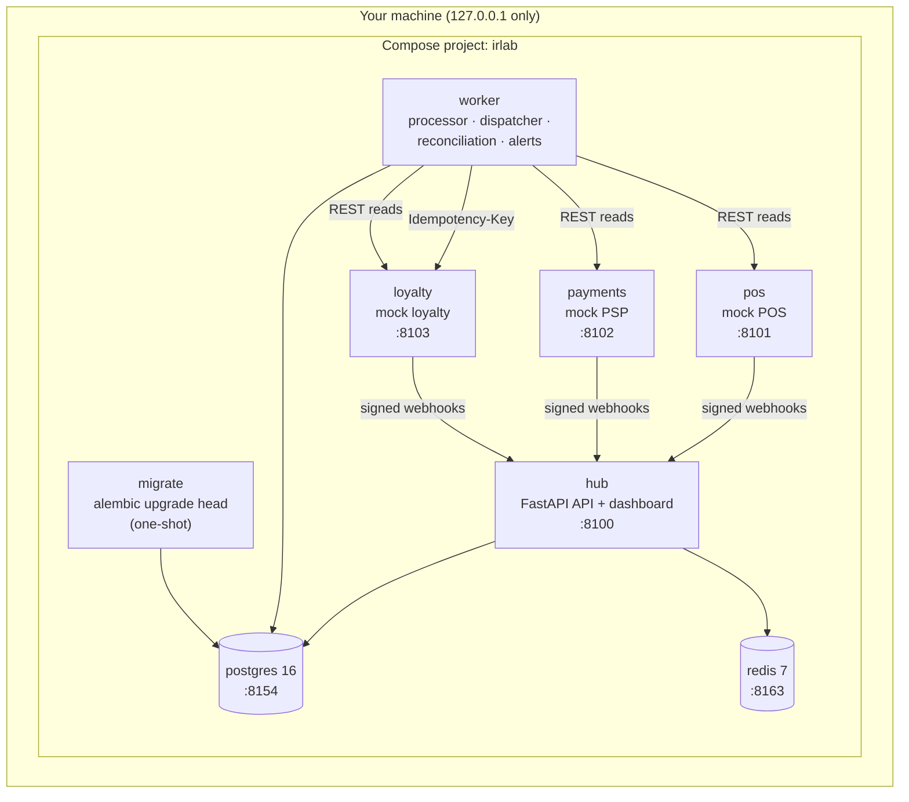

# Running with Docker Compose

The Compose stack runs every piece as a separate container, the same way it
would run at a customer site. Containers talk over HTTP. State lives in
PostgreSQL and Redis.



| Service | Image | Host port | Role |
|---|---|---|---|
| `hub` | `irlab:local` | 127.0.0.1:8100 | Webhook receiver, operator API, `/dashboard` (`RUN_WORKER=false`) |
| `worker` | `irlab:local` | — | `python -m irlab.worker`: inbox processor, outbox dispatcher, park timeouts, reconciliation every 60 s, alert evaluation |
| `pos`, `payments`, `loyalty` | `irlab:local` | 8101, 8102, 8103 | Mock providers (`irlab.mocks.serve`), each with its own in-memory state |
| `migrate` | `irlab:local` | — | `alembic upgrade head`, then exits; `hub` and `worker` wait for it |
| `postgres` | `postgres:16-alpine` | 8154 | Databases `irlab` (app) and `irlab_test` (test suite) |
| `redis` | `redis:7-alpine` | 8163 | Idempotency fast path (db 0); tests use db 15 |
| `tests` (profile `test`) | `irlab:test` | — | Runs the full pytest suite against this Postgres and Redis |

Every port is bound to `127.0.0.1`. The project name `irlab` keeps the
containers, network and volume separate from other Compose projects on the
same machine.

## Start

```bash
python -m irlab.devtools init-env
```

This writes `.env` with fresh webhook secrets, `OPS_API_KEY` and
`POSTGRES_PASSWORD`. It runs once, and `.env` is git-ignored.

```bash
docker compose up -d --build
```

```bash
docker compose ps
```

`hub` turns `healthy` after `migrate` has finished and the three providers are
healthy. Then open http://127.0.0.1:8100/dashboard and http://127.0.0.1:8100/docs.

## Walk through one order

```bash
curl -s -X POST 127.0.0.1:8101/orders -H 'content-type: application/json' -d '{"store_id":"ST-IST-01","items":[{"sku":"SKU-LATTE","qty":2}],"loyalty_member_id":"LM-1001"}'
```

Use the returned id (e.g. `POS-000001`) to pay at the payment provider:

```bash
curl -s -X POST 127.0.0.1:8102/payments -H 'content-type: application/json' -H 'Idempotency-Key: pay-POS-000001' -d '{"order_ref":"POS-000001","amount_minor":19000}'
```

Within a second the worker has projected the order and sent the loyalty
accrual:

```bash
curl -s 127.0.0.1:8100/v1/orders/POS-000001
```

Follow it in the JSON logs (one correlation id from webhook to outbox):

```bash
docker compose logs worker | grep POS-000001
```

## Inject failures

Each mock has a control plane under `/_admin`, for example:

```bash
curl -s -X PUT 127.0.0.1:8103/_admin/faults -H 'content-type: application/json' -d '{"fail_next":3}'
```

That makes loyalty fail its next 3 calls. The worker retries with backoff. All
six scenarios can be run at once with the scenario runner:

```bash
python -m irlab.scenarios --target http --orders 50 --markdown docs/results/scenarios-compose.md
```

The runner reads `OPS_API_KEY` from `.env` and uses the default URLs
`127.0.0.1:8100-8103`. It only uses the public APIs. Faults are reset after each
scenario, and the member that scenario 5 deletes is restored.

## Lab timing

To let the scenarios play out in seconds, Compose sets shorter timings than the
defaults in `.env.example`:

| Setting | Compose (lab) | Default | Override with |
|---|---|---|---|
| `PARK_TIMEOUT_S` | 5 | 300 | `LAB_PARK_TIMEOUT_S` |
| `OUTBOUND_TIMEOUT_S` | 1 | 2 | `LAB_OUTBOUND_TIMEOUT_S` |
| `RETRY_BASE_S` / `RETRY_CAP_S` | 0.2 / 5 | 0.5 / 60 | `LAB_RETRY_BASE_S`, `LAB_RETRY_CAP_S` |
| `RECONCILE_GRACE_S` | 2 | 30 | `LAB_RECONCILE_GRACE_S` |
| `RECONCILE_INTERVAL_S` | 60 | 60 | `LAB_RECONCILE_INTERVAL_S` |

The names start with `LAB_` on purpose. Compose also reads `.env` for variable
substitution, so with plain names the production-like values in `.env` would
silently replace the lab values.

## Tests against real PostgreSQL and Redis

Option 1 runs the suite inside Compose:

```bash
docker compose --profile test run --rm tests
```

Option 2 runs it from the host, against the ports Compose exposes:

```bash
export TEST_DATABASE_URL="postgresql+asyncpg://irlab:$(grep '^POSTGRES_PASSWORD=' .env | cut -d= -f2-)@127.0.0.1:8154/irlab_test"
export TEST_REDIS_URL=redis://127.0.0.1:8163/15
pytest -q
```

Each test starts from an empty schema in `irlab_test` and an empty Redis db 15.
The app database (`irlab`, Redis db 0) is never touched.

## Stop

```bash
docker compose down
```

`docker compose down -v` also deletes the `irlab_pgdata` volume, which holds
the hub's database. The command affects only this project's containers and
volume.

## What Compose does not do

- No TLS and no secret store. Secrets come from `.env`.
- One worker replica. Claims are compare-and-set with leases, and on PostgreSQL
  processing takes a per-order advisory lock, so a second replica is safe by
  design. A second replica has not been load-tested here.
- The mocks keep their state in memory. Restarting a mock container resets it
  to the seed data, and its order ids start again at `POS-000001`. The hub's
  database survives the restart, so the new ids collide with the old ones. To
  reset the lab, run `docker compose down -v`, then `docker compose up -d`.
